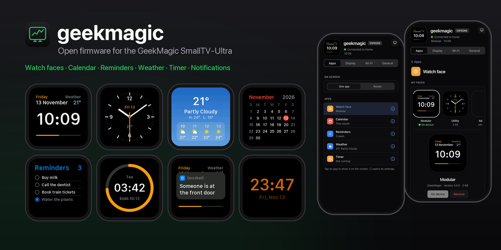

# geekmagic



[Русская версия](README.ru.md)

Open firmware for the **GeekMagic SmallTV-Ultra**, the small 240×240 desktop
display with an ESP8266. It turns the device into a calm, glanceable clock with
apps, styled after Apple's watch faces and settings.

## Features

- **Apps:** watch faces, Calendar, Reminders, Weather, Timer, Pomodoro. Show one, or let
  the screen rotate through several with a soft fade.
- **Watch faces:** two built in, *Modular* (digital, with the weather) and
  *Utility* (analog). More can be installed as packages; you can make your own.
- **Over any app:** notification banners from any script, the running timer
  or Pomodoro, and a dim Nightstand clock at night.
- **Weather** from Open-Meteo for your location, no account or key.
- **Reminders and timers from your phone:** a simple HTTP API that works with
  iPhone Shortcuts and Siri.
- **Brightness** by hand, by the light sensor, on a schedule or from sunset to
  sunrise.
- **Web page** at `http://geekmagic.local`, in English or Russian, that saves as
  you change things and installs as a home-screen app. Optional password.
- **Updates** from the web page: it tells you when a new release is out and
  installs it with one tap.
- **Wi‑Fi:** up to four networks; a setup hotspot with a QR code; recovers from
  a silent network by itself.

## Getting started

1. Download `geekmagic-<version>.bin` from the [releases](../../releases).
2. Flash it: from a device already running this firmware, **General → Software
   Update**; from the stock firmware or a blank device, over USB/UART with
   esptool (keep a backup of the stock flash first, see
   [docs/recovery.md](docs/recovery.md)).
3. Join the `GeekMagic-Setup` hotspot (scan the QR code on the screen), pick
   your Wi‑Fi network, and open `http://geekmagic.local`.
4. Set your location in **General → Location** for the weather. The clock
   starts on the Modular watch face.

## On your phone as an app

The web page can sit on your home screen and open like an app: full screen,
with its own icon, no browser bars, no zooming or scrolling past the edges.

- **iPhone, iPad:** open `http://geekmagic.local` in Safari, tap **Share →
  Add to Home Screen**.
- **Android:** open the page in Chrome, tap **⋮ → Add to Home screen**.
  Chrome makes a full app only for HTTPS pages, so over the device's plain
  HTTP it adds a shortcut that opens in the browser.

Add it from the address you will keep using: the device name
(`geekmagic.local`, or the name you set in General) survives a new IP address
from the router, an IP address does not. If you set a web password, the app
asks for it like the browser does.

## Documentation

| Document | For |
| --- | --- |
| [docs/apps.md](docs/apps.md) | What every app does, and the HTTP API |
| [docs/watch-faces.md](docs/watch-faces.md) | Making watch faces: the package format and tools |
| [docs/architecture.md](docs/architecture.md) | How the firmware works, for developers |
| [docs/development.md](docs/development.md) | Building, testing, conventions |
| [docs/recovery.md](docs/recovery.md) | Resets, crashes, going back to stock |
| [CHANGELOG.md](CHANGELOG.md) | What changed in each version |

## Project layout

```
src/            the firmware (main.cpp, web server, settings, one folder per app)
src/webui.html  the web page; src/webui.h is generated from it
faces/          the two standard watch faces (sources and .stheme packages)
tests/          host tests; tests/run_all.sh runs all of them
tools/          web page packer, watch face tools, font and icon generators
docs/           documentation
```

Build with `pio run`; see [docs/development.md](docs/development.md).

## Acknowledgements

Based on giovi321's open firmware for the SmallTV (WTFPL). Pin maps from the
ESPHome and Tasmota communities. Libraries: [Arduino_GFX](https://github.com/moononournation/Arduino_GFX),
[ArduinoJson](https://arduinojson.org/). Weather data: [Open-Meteo](https://open-meteo.com).

## License

[WTFPL](LICENSE).
