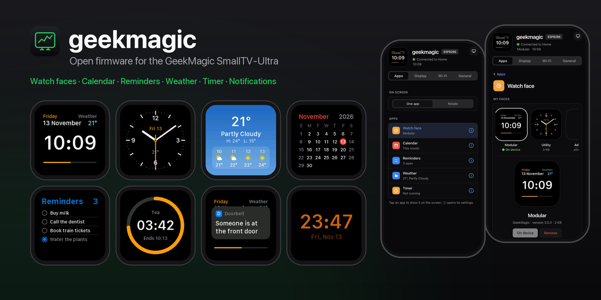

# geekmagic



[English version](README.md)

Открытая прошивка для **GeekMagic SmallTV-Ultra** — маленького настольного
дисплея 240×240 на ESP8266. Превращает его в спокойные часы с приложениями в
стиле циферблатов и настроек Apple.

## Возможности

- **Приложения:** циферблаты, Календарь, Напоминания, Погода, Таймер. Одно на
  экране или по очереди с плавной сменой.
- **Циферблаты:** встроены *Modular* (цифровой, с погодой) и *Utility*
  (стрелочный). Другие устанавливаются пакетами, можно сделать свой.
- **Поверх любого приложения:** уведомления из любых скриптов, идущий таймер и
  тусклые часы «Ночник» ночью.
- **Погода** от Open-Meteo для вашего места, без регистрации и ключей.
- **Напоминания и таймер с телефона:** простой HTTP API, работает с Быстрыми
  командами iPhone и Siri.
- **Яркость** вручную, по датчику освещённости, по расписанию или от заката до
  рассвета.
- **Веб-страница** `http://geekmagic.local` на русском или английском:
  сохраняет изменения сразу и ставится на экран «Домой» как приложение.
  Пароль по желанию.
- **Обновления** из веб-страницы: она сообщает о новом релизе и ставит его
  одним нажатием.
- **Wi‑Fi:** до четырёх сетей; точка доступа для настройки с QR-кодом; сама
  восстанавливает связь, если сеть замолчала.

## Как начать

1. Скачайте `geekmagic-<версия>.bin` в [релизах](../../releases).
2. Прошейте: с этой прошивки — **Основные → Обновление ПО**; с заводской или
   на чистое устройство — по USB/UART через esptool (сначала сохраните копию
   заводской прошивки, см. [docs/recovery.md](docs/recovery.md)).
3. Подключитесь к точке доступа `GeekMagic-Setup` (отсканируйте QR-код на
   экране), выберите свою сеть Wi‑Fi и откройте `http://geekmagic.local`.
4. Задайте место в **Основные → Местоположение** для погоды. Часы начинают
   с циферблата Modular.

## Как приложение на телефоне

Веб-страницу можно вынести на экран «Домой», и она откроется как приложение:
на весь экран, со своей иконкой, без панелей браузера, без масштабирования и
прокрутки за края.

- **iPhone, iPad:** откройте `http://geekmagic.local` в Safari, нажмите
  **Поделиться → На экран «Домой»**.
- **Android:** откройте страницу в Chrome, нажмите **⋮ → Добавить на главный
  экран**. Полноценное приложение Chrome делает только для страниц по HTTPS,
  поэтому для простого HTTP часов он добавит ярлык, который открывается в
  браузере.

Добавляйте с того адреса, которым будете пользоваться: имя устройства
(`geekmagic.local` или имя, заданное в «Основных») переживёт смену IP-адреса
роутером, а IP-адрес — нет. Если задан пароль, приложение спросит его так же,
как браузер.

## Документация

Документация для разработчиков — на английском:

| Документ | О чём |
| --- | --- |
| [docs/apps.md](docs/apps.md) | Что делает каждое приложение, HTTP API |
| [docs/watch-faces.md](docs/watch-faces.md) | Как делать циферблаты: формат пакета и утилиты |
| [docs/architecture.md](docs/architecture.md) | Как устроена прошивка |
| [docs/development.md](docs/development.md) | Сборка, тесты, правила |
| [docs/recovery.md](docs/recovery.md) | Сброс, сбои, возврат к заводской прошивке |
| [CHANGELOG.md](CHANGELOG.md) | Изменения по версиям |

## Структура

```
src/            прошивка (main.cpp, веб-сервер, настройки, по папке на приложение)
src/webui.html  веб-страница; src/webui.h собирается из неё
faces/          два стандартных циферблата (исходники и пакеты .stheme)
tests/          тесты; tests/run_all.sh запускает все
tools/          сборщик страницы, утилиты циферблатов, генераторы шрифта и иконок
docs/           документация
```

Сборка — `pio run`, подробности в [docs/development.md](docs/development.md).

## Благодарности

Основано на открытой прошивке giovi321 для SmallTV (WTFPL). Распиновка — от
сообществ ESPHome и Tasmota. Библиотеки: [Arduino_GFX](https://github.com/moononournation/Arduino_GFX),
[ArduinoJson](https://arduinojson.org/). Данные о погоде: [Open-Meteo](https://open-meteo.com).

## Лицензия

[WTFPL](LICENSE).
